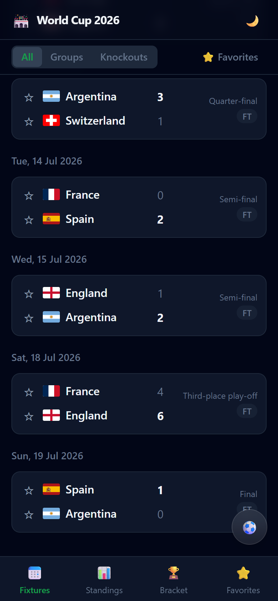
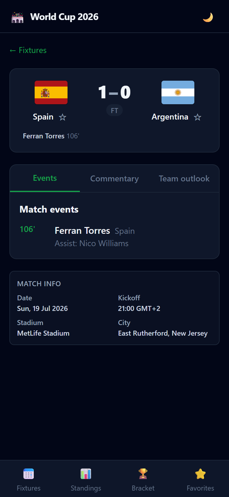
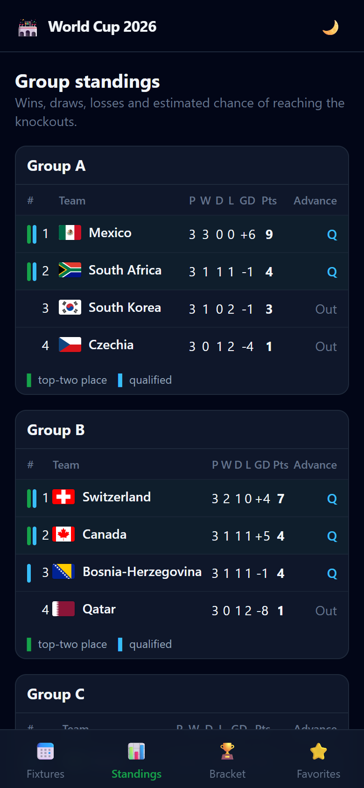
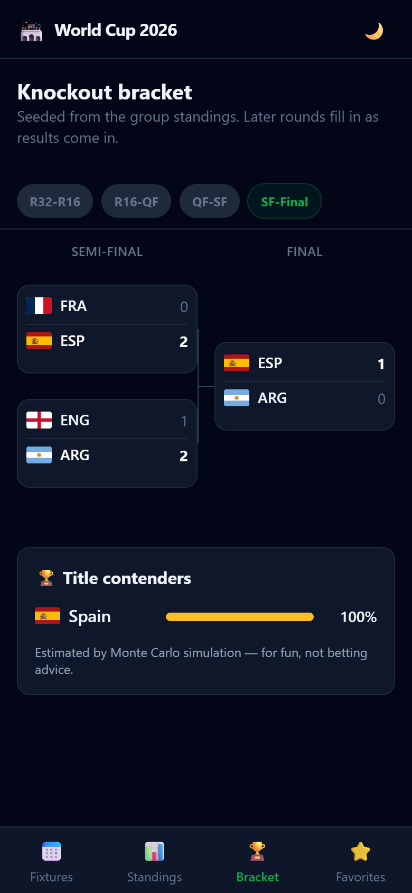
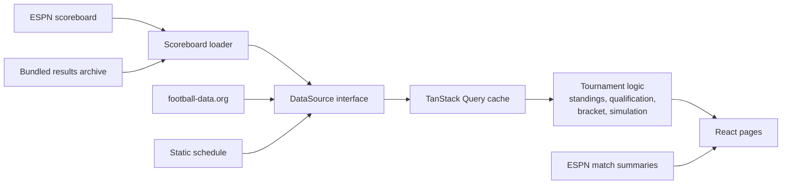

# World Cup 2026 Companion

A mobile-first web app for the 2026 FIFA World Cup, the first with 48 teams.
Fixtures in German time, live scores and scorers, group tables, the knockout
bracket and Monte Carlo title odds, in one installable app.

[](https://madniabdulwahab.github.io/fifa26/)
[](https://github.com/MadniAbdulWahab/fifa26/actions/workflows/deploy.yml)


**[Open the app](https://madniabdulwahab.github.io/fifa26/)** on a phone or
desktop. It can be installed to the home screen and keeps working offline.

> The tournament ended on 19 July 2026 with Spain beating Argentina 1–0 after
> extra time. The app now shows the completed tournament, with every result,
> the final group tables and the full bracket.

<table>
  <tr>
    <td align="center"><br><sub>Fixtures</sub></td>
    <td align="center"><br><sub>Match page</sub></td>
    <td align="center"><br><sub>Group tables</sub></td>
    <td align="center"><br><sub>Bracket</sub></td>
  </tr>
</table>

## Why I built it

I wanted to follow the 2026 World Cup from Germany without doing time-zone
maths. The matches were played across the United States, Canada and Mexico, so
many kickoffs fell late in the evening or at night German time, and it was easy
to miss the games I cared about. It was also the first World Cup with 48 teams,
where eight of the twelve third-placed teams go through, which makes the group
tables much harder to read.

So I built the app I wanted to use. Every kickoff is shown in German time,
whatever time zone the device is set to. I mark my favorite teams once, and
their matches are highlighted across the fixtures, so I can see at a glance
when they play. The tables show who is through and who is still in the race
for a best-third place. I designed and built the app myself, from the data
layer to the interface, and shared it with friends, who used it to follow the
tournament as well.

## What it does

- **Fixtures** for all 104 matches, grouped by day and shown in German time for
  every visitor.
- **Match pages** with score, goal scorers and assists, live commentary, team
  outlook and venue.
- **Group tables** with points, goal difference and qualification markers,
  including the race for the eight best third-placed teams.
- **Knockout bracket** in the official 2026 layout, with a compact view per
  round.
- **Title and advancement odds** from a Monte Carlo simulation.
- **Favorite teams** that are highlighted across the app, with kickoff
  reminders while the app is open.
- Light and dark mode, responsive navigation, installable as a PWA.

## How I built it



**One data boundary, several providers.** ESPN's API is fast and needs no key
but is undocumented, while football-data.org is documented but its free tier
needs a token and a proxy, so I didn't want the app tied to either. I put every
provider behind the
same `DataSource` interface, which maps its responses into shared TypeScript
domain types. ESPN, football-data.org and a bundled schedule can be swapped
with one environment variable, and no UI code knows which one is active.

**Keeping it working after the tournament.** After the final, the app suddenly
showed no matches at all. I traced it to ESPN, which had started rejecting the
whole-tournament date query while still answering single-day queries. I wrote
a script (`scripts/archive-espn-scoreboard.mjs`) that collects all 104 results
one day at a time, bundled the archive with the app, and made the app use it
after the tournament or whenever the live request fails. Scorers and
commentary still load per match from ESPN.

**Tournament rules as pure functions.** I kept group tables, the best
third-placed ranking, bracket seeding and qualification status in `src/lib/`
with no React code, so I could test the rules directly instead of through the
interface.

**Odds you can reproduce.** For the title and advancement odds I wrote a small
Monte Carlo simulation. It replays the remaining group games with a Poisson
goal model based on team ratings, then plays out the bracket. It runs 2,000
times with a seeded random number generator, so the same results always give
the same odds. Once the final is played, the title odds are settled rather
than simulated.

**Quality checks.** 56 Vitest tests across 10 files cover the data mapping,
the archive fallback, standings, qualification, bracket layout and the
simulation. TypeScript runs in strict mode, ESLint checks every file, and
GitHub Actions deploys `main` to GitHub Pages on every push.

## Tech stack

React 18 · TypeScript · Vite · Tailwind CSS · TanStack Query · React Router ·
Day.js · Vitest · vite-plugin-pwa · GitHub Actions · GitHub Pages

## Run it locally

```bash
npm install
npm run dev      # development server
npm test         # Vitest
npm run build    # type-check and production build
npm run lint
```

`VITE_DATA_SOURCE` selects the provider: `espn` (default), `api` for
football-data.org (needs a token and a CORS proxy, see `proxy/`) or `static`.

## Project structure

```text
src/
  app/          App shell, navigation, providers
  components/   Reusable UI
  data/         Data providers, API mapping and the results archive
  domain/       Core types
  hooks/        React hooks
  lib/          Pure tournament logic (standings, bracket, simulation)
  pages/        Route pages
  stores/       Local observable state
scripts/        Results archive and icon generation
```

## Deployment

Every push to `main` builds the app and publishes it to GitHub Pages through
`.github/workflows/deploy.yml`. Vite builds with the `/fifa26/` base path, the
router reads it from `import.meta.env.BASE_URL`, and the workflow copies
`index.html` to `404.html` so deep links such as `/fifa26/bracket` load
directly.

For a full feature walkthrough, see [ABOUT.md](ABOUT.md).

## Ownership

Copyright © Abdul Wahab Madni. All rights reserved.

This is a personal project. No open-source license is granted unless one is
added explicitly later.
